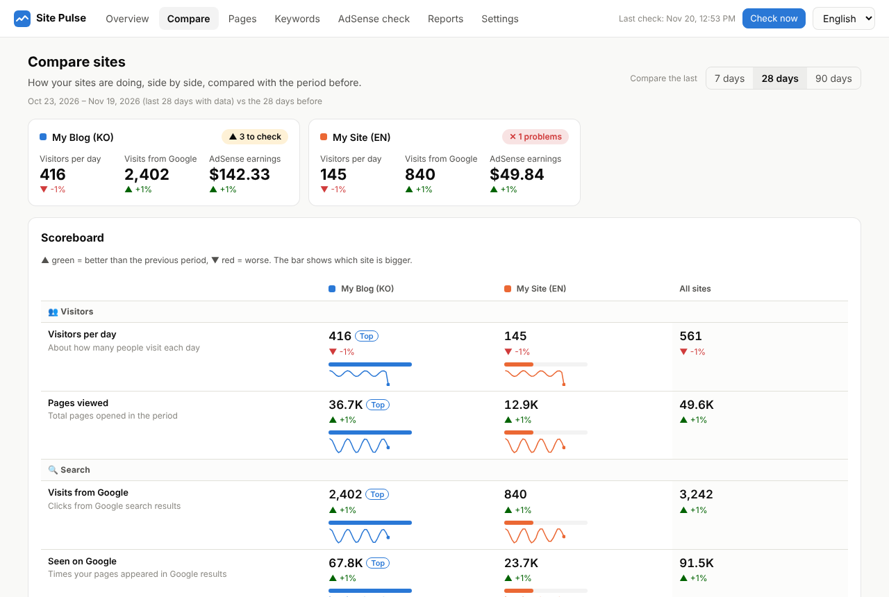
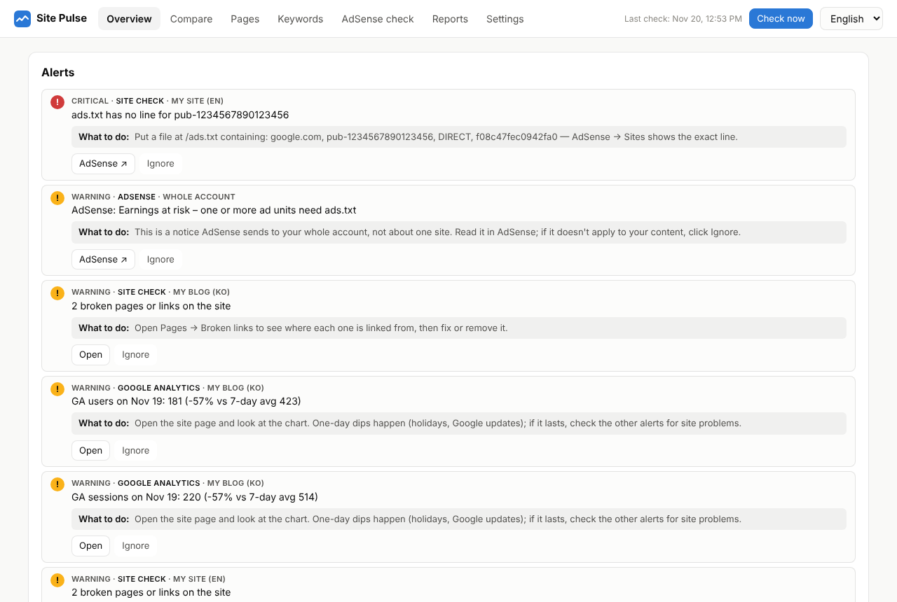
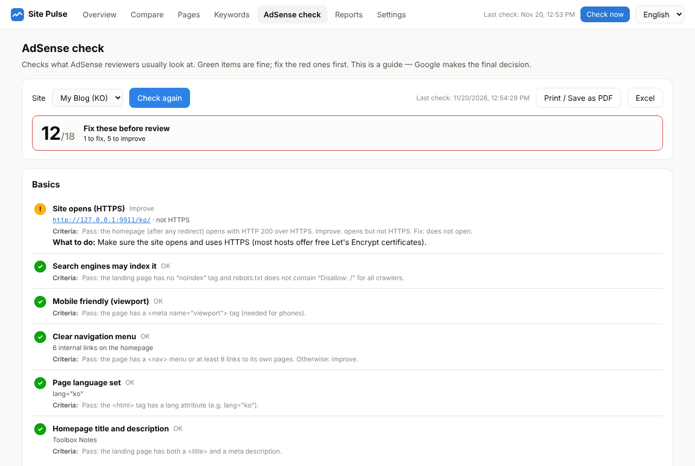
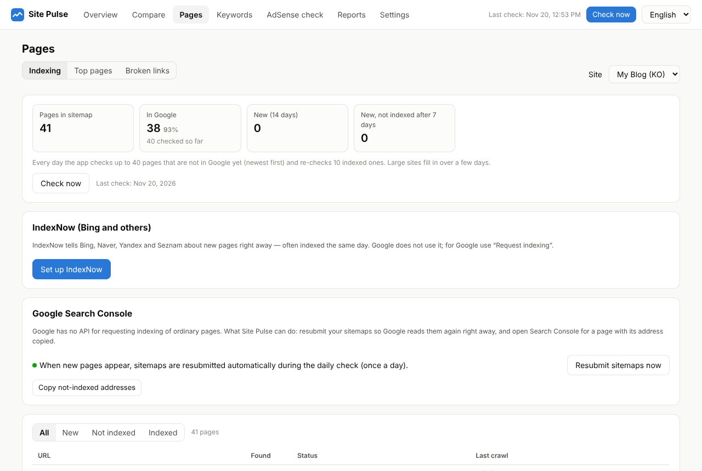
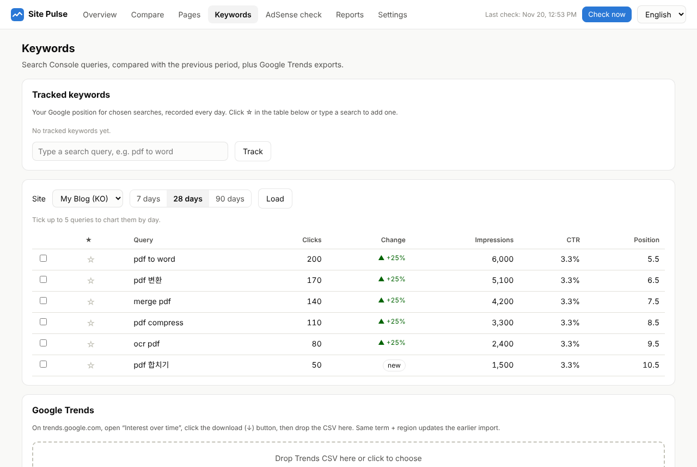

# Site Pulse

**A daily health check for your websites — Google Analytics, Search Console, AdSense and Bing in one window, explained in plain language.**

Site Pulse is a small desktop app for Windows and macOS. Once a day it checks that your sites are up and healthy, pulls your numbers from Google and Bing, and tells you what changed, what is wrong, and what to do about it. Everything runs on your own computer: it talks directly to the official APIs with your own Google sign-in, and nothing goes through a third-party server.

Made by **[Toolbox Notes](https://toolboxnotes.com/)** — a blog of free, practical tools and guides ([English](https://toolboxnotes.com/en/) · [Korean](https://toolboxnotes.com/ko/)).

## Download

**[Download the latest version →](https://github.com/toolboxnotes/site-pulse/releases/latest)**

| System | File | |
|---|---|---|
| Windows 10 / 11 (64-bit) | `Site-Pulse-Windows.zip` | [Download](https://github.com/toolboxnotes/site-pulse/releases/latest/download/Site-Pulse-Windows.zip) |
| macOS 11+ (Apple Silicon and Intel) | `Site-Pulse-Mac.zip` | [Download](https://github.com/toolboxnotes/site-pulse/releases/latest/download/Site-Pulse-Mac.zip) |

These links always give the newest version. Each release also keeps version-named copies (`Site-Pulse-Windows-v1.3.10.zip` etc.) if you need a specific version.

No installer needed: unzip and double-click **Site Pulse.exe** (Windows) or **Site Pulse.app** (macOS). Chrome or Edge should be installed for the app window. Then follow [Getting started](#getting-started) to connect your Google account.

**First run** — the app is not code-signed, so your system may warn you once:
- **Windows**: “Windows protected your PC” → click **More info → Run anyway**.
- **macOS**: right-click **Site Pulse.app → Open → Open** (or System Settings → Privacy & Security → **Open Anyway**).

All versions and changes: [Releases](https://github.com/toolboxnotes/site-pulse/releases).



---

## Features

**Daily site check**
- Is the site up? Response time (network / server / download breakdown), HTTPS, SSL certificate expiry, domain expiry (RDAP)
- `robots.txt`, sitemap, `ads.txt` (checks your AdSense publisher ID is listed), `noindex`, AdSense code on the page
- Follows JavaScript / meta-refresh language redirects, so a `/` → `/en/` landing page is checked correctly
- PageSpeed scores for mobile and desktop (LCP, INP, CLS)

**Your numbers, in one place**
- **Google Analytics 4** — visitors, sessions, page views
- **Search Console** — clicks, impressions, CTR, position, sitemap status, indexing of important pages (URL Inspection)
- **AdSense** — account and site status, alerts, policy issues, earnings by site
- **Bing Webmaster Tools** — clicks and impressions
- Sites with a path (e.g. `https://example.com/ko/`) are filtered to that section in Search Console and GA4

**Alerts you can act on**
- A drop of more than 30 % against the 7-day average (adjustable), site down, certificate or domain about to expire, `ads.txt` errors, pages not indexed, broken links, expired sign-in…
- Every alert says **where it came from**, **which site it affects**, **how to fix it**, and has a button that opens the right console. Alerts that don't apply can be ignored.
- Optional desktop notifications

**Compare and dig in**
- Compare sites side by side over 7 / 28 / 90 days — plain-language metric names, ▲ green / ▼ red
- Keywords: Search Console queries compared with the previous period, daily charts, rank tracking for keywords you star
- Import Google Trends CSV files and view them next to your search clicks
- Top pages by views and Google clicks, with the biggest risers and fallers

**Pages**
- Index tracking: finds new pages in your sitemap and checks every day whether Google has indexed them; resubmits the sitemap to Search Console automatically when new pages appear
- IndexNow: notify Bing, Naver and others about new pages instantly
- Broken-link scan: 404s, redirect chains and slow pages, with the pages that link to them

**AdSense readiness checklist**
- Checks what AdSense reviewers usually look at: privacy / about / contact pages, number and length of articles, unfinished pages, navigation, mobile viewport, `ads.txt`, indexing…
- Each item shows its pass criteria and what to do. Export as PDF or Excel.

**Reports**
- Weekly report every Monday — print / save as PDF, or download Excel

**Other**
- Interface in English, Korean and Chinese
- Move to another computer: export settings and keys to one password-encrypted file (AES-256-GCM)
- Closes completely when you close its window — no tray icon, no background service

| Overview | AdSense checklist |
|---|---|
|  |  |
| **Pages** | **Keywords** |
|  |  |

*Screenshots use demo data.*

---

## How it works

Site Pulse is a single Go program (standard library only) with the web interface embedded. When you open it, it starts a small server on `127.0.0.1` (port 17380, or the next free one) and opens an app window in Chrome (or Edge). Data is stored on your computer:

- Windows: `%APPDATA%\Site Pulse`
- macOS: `~/Library/Application Support/Site Pulse`

The server only listens on your own computer, checks the `Host` header (DNS rebinding protection) and requires a custom header on every request that changes something (cross-site protection).

## Getting started

### 1. Run it

[Download](#download) the zip for your system (or [build it yourself](#build)), unzip, and double-click `Site Pulse.exe` on Windows or `Site Pulse.app` on macOS. Chrome or Edge must be installed for the app window; otherwise it opens in your default browser.

### 2. Create your own Google OAuth client (one time, about 10 minutes)

Site Pulse does not ship with a shared Google client — you create your own, so your data stays between you and Google.

1. Go to the [Google Cloud Console](https://console.cloud.google.com/) and create a project.
2. **APIs & Services → Library** — enable:
   - Google Analytics Data API
   - Google Analytics Admin API
   - Google Search Console API
   - AdSense Management API
   - PageSpeed Insights API (optional)
3. **OAuth consent screen** — choose *External*, fill in the app name and your email. Either add your own Google account as a test user, or publish the app (it stays “unverified”, which is fine for personal use — sign-in shows *Advanced → Continue*).
4. **Credentials → Create credentials → OAuth client ID → Desktop app**, then download the JSON file.
5. In Site Pulse: **Settings → Google OAuth client → Choose JSON file**, then **Sign in with Google**.

No redirect URL needs to be registered: desktop clients accept any `http://127.0.0.1:<port>/` loopback address. Sign-in uses PKCE.

**Permissions requested**

| Scope | Why |
|---|---|
| `analytics.readonly` | Read GA4 reports |
| `adsense.readonly` | Read AdSense status, alerts and earnings |
| `webmasters` | Read Search Console data; the write part is used **only** to resubmit your sitemaps |
| `openid`, `userinfo.email` | Show which account is signed in |

### 3. Optional keys

- **Bing Webmaster Tools** — Settings → API access → API Key → *Generate*, paste it in Site Pulse.
- **PageSpeed Insights** — works without a key, but Google may throttle anonymous requests. Create an API key in Google Cloud (restrict it to the PageSpeed Insights API) and paste it in Settings.

### 4. Add your sites

Settings → Sites → enter the homepage URL and click **Auto-match**: Site Pulse picks the matching Search Console property, GA4 property, AdSense site and Bing site.

## Your keys and privacy

- Keys, tokens and data are stored **only** in the data folder on your computer. Nothing is sent anywhere except to Google, Bing, the RDAP registries, IndexNow and your own websites.
- This repository contains **no keys**. The test server in `test/fakeapi` uses obviously fake values.
- The settings export file is always encrypted with a password you choose (PBKDF2-SHA256, 600,000 rounds → AES-256-GCM). The Google sign-in is left out unless you tick the box. Keep the file and the password apart, and delete the file after moving.

## Build

Ready-made builds are on the [Releases page](https://github.com/toolboxnotes/site-pulse/releases/latest) — you only need this section to build from source. Requires [Go 1.24 or newer](https://go.dev/dl/).

**Windows only** (Command Prompt, in the source folder):

```bat
go build -trimpath -ldflags "-s -w -H=windowsgui" -o "Site Pulse.exe" .
```

The icon and version info are picked up automatically from `rsrc_windows_amd64.syso`.

**Windows + macOS packages** (macOS, Linux, or Git Bash on Windows):

```sh
./build.sh
```

This produces:

- `dist/Site Pulse.exe` — Windows (amd64, no console window)
- `dist/Site-Pulse-Mac.zip` — macOS app, Apple Silicon and Intel

The Windows icon and version info come from `rsrc_windows_amd64.syso`, generated from `build/app.rc` (e.g. with `llvm-rc` + `llvm-cvtres`) when the icon or version changes.

Run from source for development:

```sh
go run . -port 17380            # opens the app window
go run . -no-browser            # server only, open http://127.0.0.1:17380/ yourself
```

### Tests

```sh
go test ./...                   # redirect_live_test.go needs internet access
go test -run 'Test[^R]' ./...   # offline tests only
```

`test/fakeapi` is a fake Google / Bing / RDAP / PageSpeed / IndexNow server plus two fake websites, for trying the whole app without real accounts:

```sh
go run ./test/fakeapi &
SITEPULSE_FAKE_API=http://127.0.0.1:9910 SITEPULSE_DATA=/tmp/sitepulse-demo go run . -no-browser
```

## Project layout

| File | What it does |
|---|---|
| `main.go` | Start-up, single instance, app window, quit when the window closes, daily scheduler |
| `server.go` | Local HTTP API and security checks |
| `oauth.go`, `google.go` | Google sign-in (PKCE) and API calls |
| `collect.go`, `checks.go` | Daily check: site status, redirects, SSL, RDAP, robots / sitemap / ads.txt, alerts |
| `audit.go` | AdSense readiness checklist |
| `indexing.go`, `pages.go`, `links.go` | Index tracking, sitemap resubmission, IndexNow, broken links |
| `keywords.go`, `toppages.go`, `trends.go` | Keyword tracking, top pages, Google Trends import |
| `psi.go`, `timing.go` | PageSpeed and response-time breakdown |
| `xlsx.go`, `backup.go` | Excel export, encrypted settings backup |
| `store.go` | Settings and data on disk |
| `browser_*.go`, `front_windows.go` | Finding Chrome / Edge and showing the window |
| `web/index.html` | The whole interface (EN / KO / ZH) |
| `docs/README.txt` | Plain-text user guide (included in the Windows download) |
| `CHANGELOG.md` | Changes in each version |

## More from Toolbox Notes

- [All free tools](https://toolboxnotes.com/en/tools/) · [무료 도구 모음](https://toolboxnotes.com/ko/tools/)
- [Site Lens: IP lookup, domain Whois and website traffic checker](https://toolboxnotes.com/en/posts/site-lens-domain-ip-lookup/) · [한국어](https://toolboxnotes.com/ko/posts/site-lens-domain-ip-lookup/)
- [PDF Toolbox: free offline PDF converter](https://toolboxnotes.com/en/posts/offline-pdf-toolbox/) · [한국어](https://toolboxnotes.com/ko/posts/offline-pdf-toolbox/)

## Feedback

Bug reports and ideas are welcome in [Issues](../../issues), or on the [Toolbox Notes blog](https://toolboxnotes.com/).

## License

Copyright © 2026 Toolbox Notes. All rights reserved.
Free to use for personal and work purposes. Third-party notices: [THIRD-PARTY-LICENSES.txt](THIRD-PARTY-LICENSES.txt).

Site Pulse is not affiliated with or endorsed by Google or Microsoft. Google Analytics, Search Console, AdSense and PageSpeed Insights are trademarks of Google LLC; Bing is a trademark of Microsoft Corporation.
